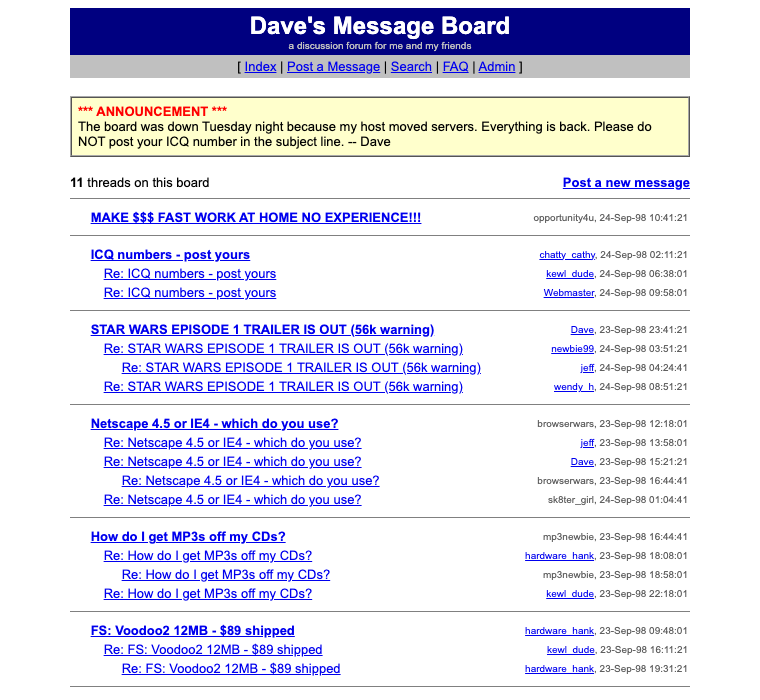

# Dave's Message Board — a PHP 3 application, 1998

A threaded bulletin board written the way PHP was written in the window when
servlets existed and JSP did not: **Servlet API 1.0 shipped June 1997, JSP 1.0
shipped June 1999**, and the PHP inside that window is **PHP 3.0, released
6 June 1998**.



## Run it

```sh
./run.sh                  # docker compose up --build
open http://localhost:8082/
```

Post with any name — there are no accounts, the board just remembers you in a
cookie. The moderator password is **letmein** (Admin → delete messages, edit
the announcement).

```sh
docker compose logs -f    # apache + mysql
docker compose down -v    # stop and wipe the database
```

Eleven threads are seeded, including a Voodoo2 for sale, a Y2K argument, and
some spam for the moderator to delete.

## What makes it 1998 and not later

Almost every modern PHP reflex is PHP 4 or newer. None of them appear here:

| Not available in 1998 | Arrived | What this board does instead |
|---|---|---|
| `foreach` | PHP 4 | `reset($a); while (list($k,$v) = each($a))` |
| `session_start()` | PHP 4 | `lib.inc` rolls its own: a random id in a cookie, a `serialize()`d array in a `sessions` table, garbage-collected on one page view in ten |
| `$_GET` / `$_POST` | PHP 4.1 | register_globals and `$HTTP_POST_VARS` |
| `===` | PHP 4 | `==` throughout |
| `include_once` | PHP 4 | `include("header.inc")` |
| `preg_*` as the default | — | `ereg()` / `eregi_replace()`, the POSIX family |
| PDO, mysqli | PHP 5 | `mysql_connect()`, `mysql_query()`, `mysql_fetch_array()` |
| subqueries, UNION | MySQL 4 | one query per thread and a loop in PHP |
| CSS you could rely on | — | tables, `<FONT>`, `BGCOLOR`, and single-pixel spacer GIFs |

Plus `<?` short tags, the `.php3` extension that Apache is configured to hand
to PHP, MyISAM tables, unix timestamps as `int(11)`, and a hit counter drawn
as six green digits on black.

**No layers.** Each page is a file: SQL, business rules and HTML in one
stream, top to bottom, with `include("header.inc")` at the top. Nobody called
this Model 1 until there was a Model 2 to distinguish it from — which is the
whole point of the comparison with `~/ebay-jsp`.

## Exactly where it is not authentic

Three deviations, all forced by the runtime, all marked in the source:

1. **The interpreter is PHP 5.6, not 3.0.** PHP 7 deleted `ereg` and the
   `mysql_*` functions, PHP 8 deleted `each()`. 5.6 is the newest release that
   still has all three, and the oldest that still builds and runs here.
2. **register_globals and `$HTTP_*_VARS` are re-created by hand.** Both were
   removed in PHP 5.4. `lib.inc` restores them in a nine-line block marked
   `------ 1998 ------`; everything below that line is period code.
3. **`magic_quotes_gpc` is gone** (removed in 5.4), so the code calls
   `addslashes()` explicitly. Careful 1998 code did that anyway, because
   relying on magic quotes and then quoting again was the most common bug on
   the web.

Two things that *look* like modern retrofits but are not: output goes through
`htmlspecialchars()` and posts are formatted with **UBB codes** — that is
exactly what the Ultimate Bulletin Board did in 1998, and the reason it did.
And the admin password is stored as an `md5()` hash, which PHP 3 had.

## The bug that proves the point

Written first, then found while testing:

```php
$id = 0;
if (isset($GLOBALS["id"])) $id = (int) $GLOBALS["id"];
```

This never reads the query string. With register_globals on, `$id` **is**
`$GLOBALS["id"]` — so assigning the default destroys the submitted value
before the next line can read it. Every page silently reported "that message
does not exist", and every post failed validation with "you must enter your
name".

The 1998 fix is the `gpc()` helper in `lib.inc`, which reads
`$HTTP_POST_VARS` / `$HTTP_GET_VARS` instead. That is most of the reason
careful code used the long arrays even when it did not have to.

## Layout

```
www/config.inc     database credentials, board name, admin hash
www/lib.inc        the register_globals shim, db helpers, hand-rolled sessions,
                   UBB formatting, date formatting, the hit counter
www/header.inc     page top, nav bar
www/footer.inc     counter, who's online, 88x31 buttons
www/index.php3     thread list, paginated, replies nested by recursion
www/read.php3      one message, its follow-ups, the reply form
www/post.php3      form and handler in one file; validates, flood-checks,
                   inserts, then redirects so a refresh cannot post twice
www/search.php3    LIKE '%...%' — MySQL 3.22 has no full-text index
www/admin.php3     moderator login, delete, announcement editor
www/faq.php3       board rules and the UBB code table
www/*.gif          folder, page and 1x1 spacer icons
sql/01-schema.sql  four MyISAM tables
sql/02-seed.sql    eleven threads of 1998
```

Dates are shifted so the board reads as 1998 whatever the server clock says.

*This is a reconstruction built to show how a database-backed web application
was written in PHP 3. Nothing here is real.*
